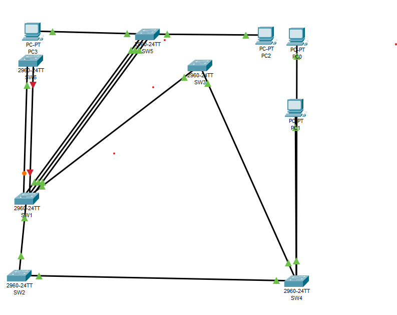
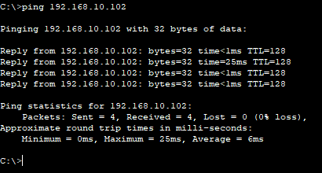
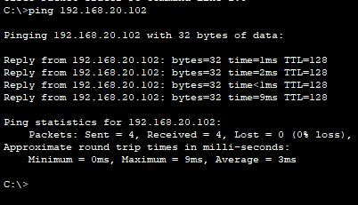

# Отчет по лабораторной работе №4
**Тема:** Spanning Tree Protocol (STP), BPDU Guard, Root Guard
**Выполнил:** Канайкин А. А., гр. 409 

## Топология


## Ответы на вопросы

### Часть 2: Анализ дерева STP "по-умолчанию"

**Вопрос 1.** Приведите вывод команды `show spanning-tree` для всех коммутаторов. На основании полученных данных определите, какой из коммутаторов выбран корнем топологии. Какие коммутаторы заблокировали свои интерфейсы для построения топологии без петель? Какие роль и состояние у заблокированных интерфейсов?

**Ответ:** 
Корневым коммутатором (Root Bridge) выбран коммутатор **SW1** (или тот, у которого наименьший Bridge ID по MAC-адресу). 
Для предотвращения петель один из портов на коммутаторах SW2, SW3 или SW5 был заблокирован. Роль заблокированного интерфейса — **Alternate (Altn)**, состояние — **Blocking (BLK)** (или **Discarding** в режиме Rapid-PVST).

SW1
```
VLAN0001
  Spanning tree enabled protocol ieee
  Root ID    Priority    16385
             Address     0060.4748.153B
             This bridge is the root
             Hello Time  2 sec  Max Age 20 sec  Forward Delay 15 sec

  Bridge ID  Priority    16385  (priority 16384 sys-id-ext 1)
             Address     0060.4748.153B
             Hello Time  2 sec  Max Age 20 sec  Forward Delay 15 sec
             Aging Time  20

Interface        Role Sts Cost      Prio.Nbr Type
---------------- ---- --- --------- -------- --------------------------------
Fa0/2            Desg FWD 19        128.2    P2p
Fa0/1            Desg FWD 19        128.1    P2p
Fa0/3            Desg FWD 19        128.3    P2p
Fa0/5            Desg LSN 19        128.5    P2p
Gi0/2            Desg FWD 4         128.26   P2p
Gi0/1            Desg FWD 4         128.25   P2p
```

SW2
```
VLAN0001
  Spanning tree enabled protocol ieee
  Root ID    Priority    16385
             Address     0060.4748.153B
             Cost        4
             Port        25(GigabitEthernet0/1)
             Hello Time  2 sec  Max Age 20 sec  Forward Delay 15 sec

  Bridge ID  Priority    32769  (priority 32768 sys-id-ext 1)
             Address     0060.5C79.D976
             Hello Time  2 sec  Max Age 20 sec  Forward Delay 15 sec
             Aging Time  20

Interface        Role Sts Cost      Prio.Nbr Type
---------------- ---- --- --------- -------- --------------------------------
Gi0/1            Root FWD 4         128.25   P2p
Gi0/2            Desg FWD 4         128.26   P2p
```

SW3
```
VLAN0001
  Spanning tree enabled protocol ieee
  Root ID    Priority    16385
             Address     0060.4748.153B
             Cost        4
             Port        25(GigabitEthernet0/1)
             Hello Time  2 sec  Max Age 20 sec  Forward Delay 15 sec

  Bridge ID  Priority    32769  (priority 32768 sys-id-ext 1)
             Address     0050.0F75.178D
             Hello Time  2 sec  Max Age 20 sec  Forward Delay 15 sec
             Aging Time  20

Interface        Role Sts Cost      Prio.Nbr Type
---------------- ---- --- --------- -------- --------------------------------
Gi0/1            Root FWD 4         128.25   P2p
Gi0/2            Desg FWD 4         128.26   P2p
```

SW4
```VLAN0001
  Spanning tree enabled protocol ieee
  Root ID    Priority    16385
             Address     0060.4748.153B
             Cost        8
             Port        26(GigabitEthernet0/2)
             Hello Time  2 sec  Max Age 20 sec  Forward Delay 15 sec

  Bridge ID  Priority    32769  (priority 32768 sys-id-ext 1)
             Address     0001.C741.5E48
             Hello Time  2 sec  Max Age 20 sec  Forward Delay 15 sec
             Aging Time  20

Interface        Role Sts Cost      Prio.Nbr Type
---------------- ---- --- --------- -------- --------------------------------
Gi0/1            Altn BLK 4         128.25   P2p
Gi0/2            Root FWD 4         128.26   P2p
```

SW5
```VLAN0001
  Spanning tree enabled protocol ieee
  Root ID    Priority    16385
             Address     0060.4748.153B
             Cost        19
             Port        1(FastEthernet0/1)
             Hello Time  2 sec  Max Age 20 sec  Forward Delay 15 sec

  Bridge ID  Priority    32769  (priority 32768 sys-id-ext 1)
             Address     00E0.8F3D.BBB6
             Hello Time  2 sec  Max Age 20 sec  Forward Delay 15 sec
             Aging Time  20

Interface        Role Sts Cost      Prio.Nbr Type
---------------- ---- --- --------- -------- --------------------------------
Fa0/1            Root FWD 19        128.1    P2p
Fa0/2            Altn BLK 19        128.2    P2p
Fa0/3            Altn BLK 19        128.3    P2p
```
### Часть 3: Настройка STP"

**Вопрос 2.** Приведите вывод команды `show spanning-tree summary` на любом из коммутаторов. В каком режиме работает протокол STP?

```text
Switch is in pvst mode
Root bridge for: default
Extended system ID           is enabled
Portfast Default             is disabled
Portfast BPDU Guard Default  is disabled
Portfast BPDU Filter Default is disabled
Loopguard Default            is disabled
EtherChannel misconfig guard is disabled
UplinkFast                   is disabled
BackboneFast                 is disabled
Configured Pathcost method used is short

Name                   Blocking Listening Learning Forwarding STP Active
---------------------- -------- --------- -------- ---------- ----------
VLAN0001                     0         0        0          5          5
VLAN0010                     0         0        0          5          5
VLAN0020                     0         0        0          5          5
---------------------- -------- --------- -------- ---------- ----------
3 vlans                      0         0        0         15         15
```

**Вопрос 3.** Повторно приведите вывод команды show spanning-tree summary на любом из коммутаторов. В каком режиме работает протокол STP теперь?

**Ответ:** Теперь протокол STP работает в режиме Rapid-PVST (Rapid Per-VLAN Spanning Tree). Это подтверждается первой строкой вывода команды (Switch is in rapid-pvst mode)
```SW1#show spanning-tree summary
Switch is in rapid-pvst mode
Root bridge for: default
Extended system ID           is enabled
Portfast Default             is disabled
PortFast BPDU Guard Default  is disabled
Portfast BPDU Filter Default is disabled
Loopguard Default            is disabled
EtherChannel misconfig guard is disabled
UplinkFast                   is disabled
BackboneFast                 is disabled
Configured Pathcost method used is short

Name                   Blocking Listening Learning Forwarding STP Active
---------------------- -------- --------- -------- ---------- ----------
VLAN0001                     0         0        0          5          5
VLAN0010                     2         0        0          4          6
VLAN0020                     2         0        0          4          6

---------------------- -------- --------- -------- ---------- ----------
3 vlans                      4         0        0         13         17
```

**Вопрос 4.** Приведите вывод команды `show spanning-tree vlan 1` на SW1, команды `show spanning-tree vlan 10` на SW2 и команды `show spanning-tree vlan 20` на SW3.

**Вывод на SW1 (VLAN 1):**
```
SW1# show spanning-tree vlan 1
VLAN0001
  Spanning tree enabled protocol ieee
  Root ID    Priority    16385
             Address     0060.4748.153B
             This bridge is the root
             Hello Time  2 sec  Max Age 20 sec  Forward Delay 15 sec

  Bridge ID  Priority    16385  (priority 16384 sys-id-ext 1)
             Address     0060.4748.153B
             Hello Time  2 sec  Max Age 20 sec  Forward Delay 15 sec
             Aging Time  20

Interface        Role Sts Cost      Prio.Nbr Type
---------------- ---- --- --------- -------- --------------------------------
Fa0/2            Desg FWD 19        128.2    P2p
Fa0/1            Desg FWD 19        128.1    P2p
Fa0/3            Desg FWD 19        128.3    P2p
Fa0/5            Desg LSN 19        128.5    P2p
Gi0/2            Desg FWD 4         128.26   P2p
Gi0/1            Desg FWD 4         128.25   P2p
```

**Вывод на SW2 (VLAN 10):**
```
SW2# show spanning-tree vlan 10
VLAN0010
  Spanning tree enabled protocol ieee
  Root ID    Priority    16394
             Address     0060.5C79.D976
             This bridge is the root
             Hello Time  2 sec  Max Age 20 sec  Forward Delay 15 sec

  Bridge ID  Priority    16394  (priority 16384 sys-id-ext 10)
             Address     0060.5C79.D976
             Hello Time  2 sec  Max Age 20 sec  Forward Delay 15 sec
             Aging Time  20

Interface        Role Sts Cost      Prio.Nbr Type
---------------- ---- --- --------- -------- --------------------------------
Gi0/1            Desg FWD 4         128.25   P2p
Gi0/2            Desg FWD 4         128.26   P2p
```

**Вывод на SW3 (VLAN 20):**
```
SW3# show spanning-tree vlan 20
VLAN0020
  Spanning tree enabled protocol ieee
  Root ID    Priority    16404
             Address     0050.0F75.178D
             This bridge is the root
             Hello Time  2 sec  Max Age 20 sec  Forward Delay 15 sec

  Bridge ID  Priority    16404  (priority 16384 sys-id-ext 20)
             Address     0050.0F75.178D
             Hello Time  2 sec  Max Age 20 sec  Forward Delay 15 sec
             Aging Time  20

Interface        Role Sts Cost      Prio.Nbr Type
---------------- ---- --- --------- -------- --------------------------------
Gi0/1            Desg FWD 4         128.25   P2p
Gi0/2            Desg FWD 4         128.26   P2p
```

**Вопрос 5.** На SW5 один порт выбран корневым для всех VLAN. Какой? Как коммутатор выбирает корневой порт при получении нескольких BPDU с равной стоимостью и одинаковым Bridge ID соседа?

**Вывод на SW5:**
```text
VLAN0001
  Spanning tree enabled protocol ieee
  Root ID    Priority    16385
             Address     0060.4748.153B
             Cost        19
             Port        1(FastEthernet0/1)
VLAN0010
  Spanning tree enabled protocol ieee
  Root ID    Priority    16394
             Address     0060.5C79.D976
             Cost        23
             Port        2(FastEthernet0/2)
VLAN0020
  Spanning tree enabled protocol ieee
  Root ID    Priority    16404
             Address     0050.0F75.178D
             Cost        14
             Port        3(FastEthernet0/3)
```

**Вопрос 6.** Приведите вывод команды `show spanning-tree` на SW5. Какие порты выбраны корневыми для VLAN1, VLAN10 и VLAN20? Проверьте связность между PC0 и PC2, между PC1 и PC3 при помощи утилиты `ping`.

**Вывод на SW5:**
```
VLAN0001
  Spanning tree enabled protocol ieee
  Root ID    Priority    16385
             Address     0060.4748.153B
             Cost        19
             Port        1(FastEthernet0/1)
             Hello Time  2 sec  Max Age 20 sec  Forward Delay 15 sec

  Bridge ID  Priority    32769  (priority 32768 sys-id-ext 1)
             Address     00E0.8F3D.BBB6
             Hello Time  2 sec  Max Age 20 sec  Forward Delay 15 sec
             Aging Time  20

Interface        Role Sts Cost      Prio.Nbr Type
---------------- ---- --- --------- -------- --------------------------------
Fa0/1            Root FWD 19        128.1    P2p
Fa0/2            Altn BLK 19        128.2    P2p
Fa0/3            Altn BLK 19        128.3    P2p

VLAN0010
  Spanning tree enabled protocol ieee
  Root ID    Priority    16394
             Address     0060.5C79.D976
             Cost        23
             Port        2(FastEthernet0/2)
             Hello Time  2 sec  Max Age 20 sec  Forward Delay 15 sec

  Bridge ID  Priority    32778  (priority 32768 sys-id-ext 10)
             Address     00E0.8F3D.BBB6
             Hello Time  2 sec  Max Age 20 sec  Forward Delay 15 sec
             Aging Time  20

Interface        Role Sts Cost      Prio.Nbr Type
---------------- ---- --- --------- -------- --------------------------------
Fa0/1            Altn BLK 19        128.1    P2p
Fa0/2            Root FWD 19        128.2    P2p
Fa0/3            Altn BLK 19        128.3    P2p
Fa0/10           Desg FWD 19        128.10   P2p

VLAN0020
  Spanning tree enabled protocol ieee
  Root ID    Priority    16404
             Address     0050.0F75.178D
             Cost        14
             Port        3(FastEthernet0/3)
             Hello Time  2 sec  Max Age 20 sec  Forward Delay 15 sec

  Bridge ID  Priority    32788  (priority 32768 sys-id-ext 20)
             Address     00E0.8F3D.BBB6
             Hello Time  2 sec  Max Age 20 sec  Forward Delay 15 sec
             Aging Time  20

Interface        Role Sts Cost      Prio.Nbr Type
---------------- ---- --- --------- -------- --------------------------------
Fa0/1            Altn BLK 19        128.1    P2p
Fa0/2            Altn BLK 19        128.2    P2p
Fa0/3            Root FWD 10        128.3    P2p
Fa0/11           Desg FWD 19        128.11   P2p
```
**Ответ:** Корневые порты на SW5:

Для VLAN 1 — Fa0/1.

Для VLAN 10 — Fa0/2.

Для VLAN 20 — Fa0/3 (стоимость изменена на 10).

Результаты проверки связности:

Ping с PC0 до PC2 — успешно (100%).

Ping с PC1 до PC3 — успешно (100%).




**Вопрос 7.** Используйте команду `show spanning-tree interface Fa0/10 detail` на SW4, чтобы убедиться в том, что интерфейс работает в режиме Portfast. Какую команду надо использовать, чтобы перевести магистральный интерфейс в режим Portfast? При подключении каких устройств так можно делать и при каких строго не рекомендуется?

**Вывод на SW4:**
```text
SW4# show spanning-tree interface Fa0/10 detail
Port 10 (FastEthernet0/10) of VLAN0010 is designated forwarding
  Port path cost 19, Port priority 128, Port Identifier 128.10
  Designated root has priority 16394, address 0060.5C79.D976
  Designated bridge has priority 32778, address 0001.C741.5E48
  Designated port id is 128.10, designated path cost 19
  Timers: message age 16, forward delay 0, hold 0
  Number of transitions to forwarding state: 1
  The port is in the portfast mode
  Link type is point-to-point by default
```

**Ответ:** Интерфейс работает в режиме Portfast, что подтверждается строкой The port is in the portfast mode.

Для перевода магистрального интерфейса в режим Portfast используется команда: spanning-tree portfast trunk.

Делать это можно при подключении серверов или конечных устройств (которые не генерируют BPDU).

Строго не рекомендуется для портов между коммутаторами, так как это может привести к образованию петель.

**Вопрос 8.** Используйте команду `show interface Fa0/4` на коммутаторе SW1, приведите её вывод. В каком состоянии находится интерфейс? Опишите, какое событие привело порт в это состояние.

**Вывод на SW1:**
```text
SW1# show interface Fa0/4
FastEthernet0/4 is down, line protocol is down (err-disabled)
  Hardware is Lance, address is 000c.cf33.5604 (bia 000c.cf33.5604)
  BW 100000 Kbit, DLY 1000 usec,
     reliability 255/255, txload 1/255, rxload 1/255
  Encapsulation ARPA, loopback not set
  Keepalive set (10 sec)
  Full-duplex, 100Mb/s
  input flow-control is off, output flow-control is off
  ARP type: ARPA, ARP Timeout 04:00:00
  Last input 00:00:08, output 00:00:05, output hang never
  Last clearing of "show interface" counters never
  Input queue: 0/75/0/0 (size/max/drops/flushes); Total output drops: 0
  Queueing strategy: fifo
  Output queue :0/40 (size/max)
  5 minute input rate 0 bits/sec, 0 packets/sec
  5 minute output rate 0 bits/sec, 0 packets/sec
     956 packets input, 193351 bytes, 0 no buffer
     Received 956 broadcasts, 0 runts, 0 giants, 0 throttles
     0 input errors, 0 CRC, 0 frame, 0 overrun, 0 ignored, 0 abort
     0 watchdog, 0 multicast, 0 pause input
     0 input packets with dribble condition detected
     2357 packets output, 263570 bytes, 0 underruns
     0 output errors, 0 collisions, 10 interface resets
     0 babbles, 0 late collision, 0 deferred
     0 lost carrier, 0 no carrier
     0 output buffer failures, 0 output buffers swapped out
```

**Ответ:** Интерфейс Fa0/4 находится в состоянии err-disabled (или down). Это произошло потому, что на порту был включен механизм BPDU Guard. При подключении коммутатора SW6, он начал отправлять BPDU-пакеты. BPDU Guard воспринял это как потенциальную угрозу петли и принудительно отключил порт для защиты сети.

**Вопрос 9.** Используйте команду `show spanning-tree inconsistentports` на коммутаторе SW1 для просмотра несогласованных портов, приведите её вывод. Какой интерфейс там есть? Опишите, какое событие привело интерфейс в это состояние.

**Вывод на SW1:**
```text
SW1# show spanning-tree inconsistentports
Name                 Interface            Inconsistency
-------------------- -------------------- --------------------------
VLAN0001             FastEthernet0/5      Root Inconsistent

Number of inconsistent ports (segments) in the system : 1
```

 **Ответ:** В выводе присутствует интерфейс Fa0/5 со статусом Root Inconsistent. Это состояние возникло потому, что на порту был включен механизм Root Guard. Коммутатор SW6 (с приоритетом 4096) попытался стать корневым, отправив BPDU. Root Guard предотвратил это, переведя порт в несогласованное состояние, чтобы защитить текущую топологию STP от захвата роли корня.